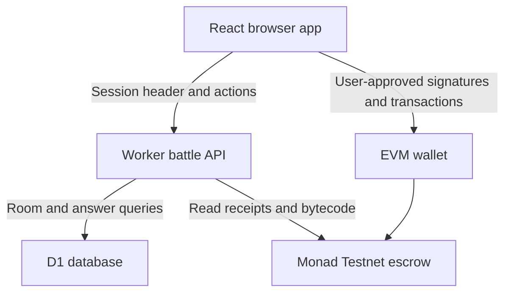
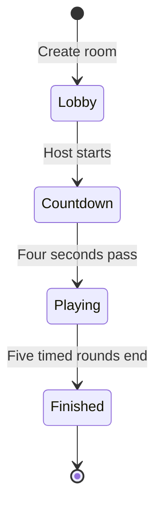

# Architecture

The browser handles presentation. The Worker controls quiz state and checks transactions. D1 stores the durable game record. Monad stores prize escrow and allocations.

## A battle's lifecycle

There is no background job moving the question forward. `position(started, serverNow)` derives the active round from the stored start timestamp. Polling clients receive the same authoritative timing even if a tab sleeps or reloads. A player can join only before the start timestamp is set. The host participates too.

A normal room requires two players, or the host may atomically convert an unsponsored one-player room to solo practice. A concurrent join prevents that conversion. Sponsored rooms additionally require registered funding and a linked wallet for every participant.

## Data model

| Table | Important fields | Constraints and purpose |
| --- | --- | --- |
| `rooms` | `code`, `title`, `pack`, `host`, `created`, `started`, `practice`, `sponsored`, reward receipt fields | Six-character primary key; `host` is the hashed session identity. |
| `players` | `id`, `room`, `session`, `name`, `wallet`, `joined` | Unique `(room, session)` and `(room, wallet)` stop duplicate membership/wallets within a room. |
| `answers` | `player`, `room`, `question`, `choice`, `correct`, `points`, `at` | Primary key `(player, question)` locks each answer once. |

The schema is in `db/schema.ts`; the actual initial SQL is `drizzle/0000_closed_jubilee.sql`. Rooms and answers survive browser refresh and Worker restarts. No automatic data-retention policy or deletion UI is implemented.

## Session and battle-start fix

`lib/session.ts` generates a random 256-bit token. The server stores only its SHA-256 session identifier in game records. The token is a credential; the hash returned in public/home state is not a credential.

`lib/client-api.ts` serializes initial session setup. It first uses a valid locally saved token; otherwise one handshake adopts the existing cookie or creates a fresh token. All requests await that handshake, then send `X-Blitz-Session`. This prevents competing first requests from creating different player identities when cookies are blocked. The token stays out of invite URLs.

The client also ignores responses for a previously selected room. Creation enters the new lobby before auto-starting practice, so a failed start remains visible and retryable. Browser storage loss still cannot be used to recover ownership by display name.

## Scoring and disclosure

`lib/questions.ts` contains the server-only question bank and scoring functions. Correct answers earn a base 100 plus up to 50 based on server receipt time. The API never accepts a client-provided score. Current-round correctness is hidden; published leaderboard totals include completed rounds. Full answers and explanations are returned when the battle finishes.

The bank is included in public source for reproducibility, so this is a learning game, not a secure examination system. The client polls the room every two seconds; no WebSocket service is required.

## Reward boundary

A pool ID is `keccak256("BlitzBattle:" + roomCode)`. One deployed contract can hold many independent pools. The browser uses an injected wallet for transactions; the backend has no signer key.

When registering funding or settlement, the API checks the network, successful receipt, recipient, exact deployed bytecode, sponsor, room event and expected winners. A rejected settlement registration cannot undo an already mined malicious settlement. The sponsor remains trusted to report winners honestly.

Build integration in `build/` and connector utilities are inherited infrastructure. The current quiz does not invoke connected apps or an AI model.
